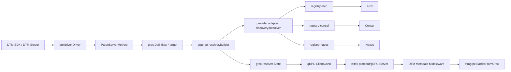

# DTM Kitex gRPC 插件设计

> 状态：设计稿（已按外部技术评审修订）
>
> 修订：v1.1 — 修正 grpc-go resolver 注册时机、补 `UpdateState` 失败语义、空结果宽限、注册生命周期、`dial_timeout` 默认值、单向 TLS 与凭证引用模型、上游环境变量说明
>
> 修订：v1.2 — 注册中心由仅 etcd 扩展为 etcd（Kitex 布局）、Consul、Nacos 三种 scheme，新增 provider 抽象与 per-scheme 凭证模型
>
> 目标仓库：`github.com/dtm-labs/dtmdriver-kitex`
>
> 插件名：`dtm-driver-kitex`
>
> 首期注册中心：etcd（Kitex `registry-etcd` 布局）、Consul、Nacos
>
> 传输协议：标准 gRPC / HTTP2

## 1. 摘要

本文设计一个面向 CloudWeGo Kitex 的 DTM 微服务驱动，使 DTM Server 和 DTM Go 客户端能够通过 Kitex 的服务注册与发现能力调用 Kitex protobuf/gRPC 服务。

第一版沿用 `dtmdriver-gozero` 的产品模型：

- 使用 `dtmdriver.Driver` 接入 DTM；
- 使用 URI/YAML 配置注册中心和服务名；
- 在包初始化阶段向 grpc-go 注册三个带 `kitex-` 前缀的 resolver scheme，`RegisterAddrResolver` 保持幂等空实现；
- 在 `RegisterService` 中按 URI scheme 把 DTM Server 注册到对应注册中心；
- 在 `ParseServerMethod` 中把分支 URL 拆为 grpc-go target 和 gRPC full method；
- DTM Server 与业务端之间始终使用标准 gRPC，不使用 TTHeader/Thrift。

第一版支持以下三种注册中心，覆盖 CloudWeGo 官方 `registry-*` 插件的全部后端：

| scheme | 后端 | 数据布局 | 对应 go-zero 能力 |
|---|---|---|---|
| `kitex-etcd://` | etcd | Kitex `registry-etcd` JSON value（默认前缀 `kitex/registry-etcd`） | etcd |
| `kitex-consul://` | Consul agent | Consul agent service + health check | consul |
| `kitex-nacos://` | Nacos naming | Nacos 实例（group/cluster 命名空间） | nacos |

三个 scheme 均带 `kitex-` 前缀，避免与 go-zero 等驱动在进程内注册的裸 `etcd`/`consul`/`nacos` grpc resolver scheme 发生覆盖。

不实现 go-zero 的 `discov` 布局：Kitex 生态有官方 `registry-etcd`，`discov` 是 go-zero 自有的 etcd 布局，为它维护一份自实现的 JSON/纯文本双格式读写器没有对等收益（决策记录见 §27）。

插件内部通过 provider 抽象接入各注册中心：每个 provider 负责构造 Kitex `discovery.Resolver` 与 `registry.Registry` 兼容实现，再由公共适配层把 `discovery.Result` 转成 grpc-go `resolver.State` 并统一实现定时刷新、空结果宽限和连接池，而不是为每个注册中心重复实现这些机制。

此外，插件提供一个 Kitex 服务端 metadata middleware，把 Kitex nphttp2 metadata 转换为 grpc-go metadata context，使现有 `dtmgrpc.BarrierFromGrpc(ctx)` 可以读取 `dtm-gid`、`dtm-trans_type`、`dtm-branch_id`、`dtm-op` 等事务元数据。

## 2. 背景与问题

DTM 的 `dtmdriver.Driver` 并不实现 Saga、TCC、XA、Msg 或 barrier 算法。事务状态机和重试逻辑仍由 DTM 核心及 DTM SDK 实现。driver 只处理三件事：

1. 注册 gRPC 地址解析器；
2. 注册 DTM Server 自身；
3. 将业务分支 URI 拆成 grpc-go dial target 与 gRPC method。

接口如下：

```go
type Driver interface {
    GetName() string
    RegisterAddrResolver()
    RegisterService(target string, endpoint string) error
    ParseServerMethod(uri string) (server string, method string, err error)
}
```

DTM 业务分支最终通过 grpc-go 调用：

```go
server, method, err := dtmdriver.GetDriver().ParseServerMethod(url)
conn := dtmgimp.MustGetGrpcConn(server, isRaw)
err = conn.Invoke(ctx, method, request, reply)
```

因此，Kitex 插件的本质是：

```text
DTM URI
  -> grpc-go resolver
  -> Kitex discovery.Resolver
  -> Kitex registry 中的服务实例
  -> 标准 gRPC
  -> Kitex protobuf/gRPC Server
```

## 3. 设计目标

### 3.1 必须实现

- 实现完整的 `dtmdriver.Driver` 接口；
- 支持直连地址，例如 `127.0.0.1:8888/pkg.Service/Method`；
- 支持 `kitex-etcd://`（Kitex `registry-etcd` 布局）、`kitex-consul://`、`kitex-nacos://` 三种服务发现；
- 使用 Kitex `registry-etcd`、`registry-consul`、`registry-nacos` 读写各注册中心原生数据，不为任何后端自实现一套注册数据格式；
- 支持各后端的多 endpoint、认证、TLS 与命名空间/分组参数；
- 支持 etcd 命名凭证引用、prefix、dial timeout、刷新周期、空结果宽限期、默认权重，以及单向 TLS / mTLS 的严格初始化；
- 支持把 DTM Server 注册为对应注册中心里的一个服务实例；
- 支持 DTM Server 从已持久化的 protobuf payload 发起 raw gRPC 调用；
- 支持 DTM 标准事务 metadata；
- 支持 grpc-go 的 `pick_first` 和 `round_robin`；
- URI 解析失败时返回可诊断错误，不 panic；
- 提供单元测试和三种注册中心的集成测试。

### 3.2 第一版不实现

- TTHeader/Thrift 调用；
- Hertz/HTTP 服务发现；
- go-zero `discov` etcd 布局（该布局是 go-zero 自有格式，由 go-zero driver 承担；DTM 若需同时访问两类服务，按 §27 的决策说明分进程部署）；
- ZooKeeper、Polaris、Eureka；
- Kitex 自定义路由、熔断、重试和 Kitex client middleware；
- 将 DTM 事务算法复制到插件；
- 修改 DTM 核心事务状态机；
- 一个 DTM 进程同时启用多个 `dtmdriver.Driver`；
- 对 registry tag 做 Kitex 业务级路由。

### 3.3 非目标说明

Kitex 支持多种协议并不意味着 DTM 能直接调用所有 Kitex 服务。该插件只适用于由 protobuf IDL 生成、开启标准 gRPC/HTTP2 的 Kitex Server。纯 TTHeader/Thrift 服务不在支持范围内。

## 4. 与 go-zero driver 的关系

本设计采用与 `dtmdriver-gozero` 相同的外部模型：

| 能力 | go-zero driver | Kitex driver |
|---|---|---|
| DTM SPI | `dtmdriver.Driver` | `dtmdriver.Driver` |
| 配置方式 | YAML + URI | YAML + URI |
| 注册中心 | etcd / discov / consul / nacos | etcd / consul / nacos |
| resolver 注册 | `resolver.Register()`，占用裸 scheme | 注册三个 `kitex-` 前缀 scheme，互不覆盖 |
| DTM 服务注册 | 按 URI scheme 注册 | 按 URI scheme 注册到对应注册中心 |
| URI 拆分 | 第一段为服务名，后续为 method | 第一段为服务名，后续为 method |
| 事务协议 | DTM 核心负责 | DTM 核心负责 |

本插件不比 go-zero driver 少支持「etcd」，只是布局不同：go-zero 的 etcd 能力由两层组成——`etcd://` 走 Kitex 风格的 etcd 注册中心，`discov://` 走 go-zero 自有的 etcd 布局。Kitex 生态的官方 etcd 插件是 `registry-etcd`，它与 Kitex 服务端 `registry-etcd` 注册的数据完全一致，因此本插件只实现 `kitex-etcd`（即 go-zero driver 中 `etcd://` 那一层）。Consul、Nacos 两个后端的实例实体同为 `host:port`（Kitex 注册时通过 Consul tag / Nacos metadata 携带的框架标记不影响地址解析），因此同一个 Consul/Nacos 集群可以同时被 Kitex 与 go-zero 服务使用。

`discov` 布局被排除：它把 value 写成纯文本 `host:port`、key 写成 `svc/<md5(ak+sk)>/<leaseID>`，与 `registry-etcd` 的 JSON value 不兼容。为一个框架自有格式维护第二套 etcd 读写器，只会增加双格式歧义和测试面，而对 Kitex 用户没有收益——Kitex 服务不会注册到 discov 布局下。

Kitex 版不会直接复制 go-zero driver 的以下行为：

- 不占用通用 `etcd` scheme；
- 不在 URI 错误时返回空 server/method 和 nil error；
- 不使用未经校验的字符串切片；
- 不把 query 留在 gRPC method 中；
- 不忽略非法端口、非法 duration 和未知参数；
- 不为每个 gRPC connection 创建无法回收的 etcd client；
- 不依赖“连接失败后才更新”的被动刷新机制。

## 5. 总体架构



组件边界：

```text
dtmdriver adapter
├── URI parser（3 个 kitex-* scheme + 直连）
├── provider 工厂
│   ├── etcdProvider        → registry-etcd
│   ├── consulProvider      → registry-consul
│   └── nacosProvider       → registry-nacos v0.1.3（nacos-sdk-go v1）
├── grpc-go resolver bridge（各 provider 共用）
│   ├── resolver cache / pool
│   └── refresh loop / empty grace / backoff
├── DTM service registrar（按 scheme 分发）
└── Kitex server metadata middleware
```

## 6. 仓库与包结构

建议建立独立仓库：

```text
dtmdriver-kitex/
├── go.mod
├── go.sum
├── LICENSE
├── README.md
├── driver.go
├── target.go
├── target_test.go
├── resolver_builder.go
├── resolver_builder_test.go
├── resolver.go
├── resolver_test.go
├── registry.go
├── registry_test.go
├── middleware.go
├── middleware_test.go
├── provider.go              # provider 接口与分发
├── provider_etcd.go         # registry-etcd 布局
├── provider_consul.go       # registry-consul
├── provider_nacos.go        # registry-nacos v0.1.3
├── provider_*_test.go
├── credentials.go           # 命名凭证（credential profile）解析
├── internal/
│   └── testkit/
│       ├── fake_discovery.go
│       └── fake_clientconn.go
└── integration/
    ├── docker-compose.yml   # etcd + consul + nacos
    ├── proto/
    ├── kitex_server/
    └── driver_integration_test.go
```

包名建议为 `dtmkitex`：

```go
import dtmkitex "github.com/dtm-labs/dtmdriver-kitex"
```

不建议使用过于宽泛的 `driver` 作为包名，避免业务代码中出现多个无法区分的 `driver` import alias。

## 7. 公开 API

### 7.1 常量

```go
const (
    DriverName    = "dtm-driver-kitex"
    SchemeEtcd    = "kitex-etcd"
    SchemeConsul  = "kitex-consul"
    SchemeNacos   = "kitex-nacos"
)
```

### 7.2 自动注册

```go
func init() {
    dtmdriver.Register(defaultDriver)
}
```

使用者只需匿名导入：

```go
import _ "github.com/dtm-labs/dtmdriver-kitex"
```

随后配置：

```yaml
MicroService:
  Driver: dtm-driver-kitex
  Target: kitex-etcd://127.0.0.1:2379/dtm-service
  EndPoint: 10.0.0.10:36790
  # 也支持：
  #   kitex-consul://127.0.0.1:8500/dtm-service?credential_profile=dtm
  #   kitex-nacos://127.0.0.1:8848/dtm-service?credential_profile=dtm
```

### 7.3 服务端 metadata middleware

```go
func ServerMetadataMiddleware(next endpoint.Endpoint) endpoint.Endpoint
```

Kitex Server 使用方式：

```go
svr := orderservice.NewServer(
    new(OrderServiceImpl),
    server.WithServiceAddr(addr),
    server.WithRegistry(registry),
    server.WithMiddleware(dtmkitex.ServerMetadataMiddleware),
)
```

该 middleware 只做 metadata context 适配，不执行 barrier SQL，也不改变 handler 的返回值。

### 7.4 第一版不暴露构造器

第一版不暴露进程级 `NewDriver(Options)` 或 `Register(driver)` API。原因是 DTM SPI 自身使用全局 driver，grpc-go resolver registry 也使用全局 scheme；公开多实例 API 会暗示实际上不存在的多实例隔离能力。

内部通过未导出接口注入 provider，以便测试：

```go
type providerSet interface {
    Lookup(scheme string) (provider, error)
}
```

`provider` 接口定义见 §10.2。

## 8. URI 契约

### 8.1 直连 URI

格式：

```text
host:port/<grpc-service>/<method>
```

示例：

```text
127.0.0.1:8888/order.v1.OrderService/Create
```

解析结果：

```text
server = 127.0.0.1:8888
method = /order.v1.OrderService/Create
```

直连只允许一个 `/` 前的 authority，不接受 query。

### 8.2 Kitex 注册中心发现 URI

三种注册中心共用同一 URI 形状，scheme 标识后端：

```text
kitex-<backend>://<backend-addresses>/<discovery-service>/<grpc-service>/<method>?<options>
```

示例：

```text
kitex-etcd://127.0.0.1:2379/order-service/order.v1.OrderService/Create
kitex-consul://127.0.0.1:8500/order-service/order.v1.OrderService/Create
kitex-nacos://127.0.0.1:8848/order-service/order.v1.OrderService/Create
```

多 endpoint（逗号分隔，仅 `kitex-etcd` 支持多地址）：

```text
kitex-etcd://10.0.0.1:2379,10.0.0.2:2379/order-service/order.v1.OrderService/Create
```

带参数：

```text
kitex-etcd://10.0.0.1:2379,10.0.0.2:2379/order-service/order.v1.OrderService/Create?prefix=kitex%2Fregistry-etcd&dial_timeout=3s&refresh_interval=5s
```

解析结果：

```text
server = kitex-etcd://10.0.0.1:2379,10.0.0.2:2379/order-service?prefix=kitex%2Fregistry-etcd&dial_timeout=3s&refresh_interval=5s
method = /order.v1.OrderService/Create
```

server 部分保留 scheme、地址列表、服务名与全部 query，供 grpc-go 走对应 resolver scheme；method 部分与注册中心无关。

### 8.3 DTM Server 注册 URI

`MicroService.Target` 没有 gRPC method，只包含注册中心和服务名：

```text
kitex-etcd://10.0.0.1:2379,10.0.0.2:2379/dtm-service?prefix=kitex%2Fregistry-etcd
```

`MicroService.EndPoint` 是 DTM gRPC Server 可被其他节点访问的地址：

```text
10.0.0.10:36790
```

### 8.4 Query 参数

通用参数（三个 scheme 都接受）：

| 参数 | 类型 | 默认值 | 用途 |
|---|---:|---:|---|
| `credential_profile` | string | 空 | 命名凭证引用，替代 URI 内明文密码 |
| `refresh_interval` | duration | `5s` | discovery 结果刷新周期 |
| `empty_grace` | duration | `30s` | 权威空结果的宽限期，超时后下发空 state |
| `default_weight` | int | `10` | 非正权重实例的默认权重 |

`kitex-etcd` 参数：

| 参数 | 类型 | 默认值 | 用途 |
|---|---:|---:|---|
| `prefix` | string | `kitex/registry-etcd` | Kitex etcd key prefix |
| `user` | string | 空 | etcd 用户名 |
| `password` | string | 空 | etcd 密码 |
| `dial_timeout` | duration | `3s` | etcd 建连超时 |
| `tls_ca` | path | 空 | etcd CA 文件；单独出现即启用单向 TLS |
| `tls_cert` | path | 空 | etcd 客户端证书，仅 mTLS 使用 |
| `tls_key` | path | 空 | etcd 客户端私钥，仅 mTLS 使用 |
| `tls_server_name` | string | 空 | 覆盖 TLS SNI 与证书校验名 |

`kitex-consul` 参数：

| 参数 | 类型 | 默认值 | 用途 |
|---|---:|---:|---|
| `scheme` | string | `http` | Consul HTTP API 协议，`https` 时启用 TLS |
| `datacenter` | string | 空 | Consul datacenter；空表示默认 DC |
| `token` | string | 空 | Consul ACL token；优先用 `credential_profile` |
| `check_interval` | duration | `5s` | health check 间隔 |
| `check_timeout` | duration | `5s` | health check 超时 |
| `deregister_after` | duration | `1m` | check 失败后注销实例的宽限时间 |

参数直接映射 `registry-consul` 的 `WithCheck` 选项。注册、注销和发现走同一个 Consul agent/HTTP API 地址。

`kitex-nacos` 参数：

| 参数 | 类型 | 默认值 | 用途 |
|---|---:|---:|---|
| `group` | string | `DEFAULT_GROUP` | Nacos 实例分组 |
| `cluster` | string | `DEFAULT` | Nacos 集群名 |
| `namespace` | string | 空 | Nacos namespaceId（空 = public） |
| `username` | string | 空 | Nacos 账号；优先用 `credential_profile` |
| `password` | string | 空 | Nacos 密码 |

直接映射 `registry-nacos` v0.1.3 的 `WithCluster`/`WithGroup` 选项与 `nacos-sdk-go` v1.1.5 的 `ClientConfig`。

校验规则：

- 未知 query 参数直接返回错误；
- 参数只按其所在 scheme 校验：etcd 参数出现在 `kitex-consul` URI 中属于未知参数；
- `user` 和 `password` 必须同时出现（`kitex-nacos` 同理 `username`/`password`），除非密码为空是后端明确允许的账号配置；第一版按“同时出现”严格校验；
- `credential_profile` 与 URI 内明文凭证（`password`、`token`）互斥，同时出现直接报错；
- `kitex-etcd`：`tls_ca` 单独出现即表示单向 TLS，只校验服务端证书；`tls_cert` 与 `tls_key` 必须成对出现且必须同时提供 `tls_ca`，用于 mTLS；只给其中一个时报错；TLS 最低版本固定为 TLS 1.2，不接受 query 调低；`tls_server_name` 只影响 SNI 与证书校验名，不改变拨号地址；
- `refresh_interval` 最小为 `1s`，最大为 `10m`；
- `empty_grace` 最小为 0，最大为 `10m`；取 0 表示空结果立即下发空 state；
- `dial_timeout`（`kitex-etcd`）必须大于 0；缺省按 `3s` 处理，超过 `1m` 截断为 `1m`；
- `default_weight` 必须大于 0；
- endpoint 必须是合法的 `host:port`，不允许空项；`kitex-consul`/`kitex-nacos` 的 authority 必须是单个 `host:port`，多地址只在 `kitex-etcd` 支持；
- discovery service 不能为空且不能包含 `/`；
- gRPC service 和 method 都不能为空；
- fragment 和 userinfo 禁止使用。

### 8.5 凭证风险

DTM 会持久化分支 URL，因此把 `user`、`password`、`token` 或 TLS 文件路径放进业务分支 URL，会让凭证进入事务表、日志和追踪系统。第一版采用“引用优先”策略：

- `credential_profile` 是第一版的一等能力：URI 里只出现 profile 名，真实的后端账号、密码、token 与证书路径由进程级配置注入，从而保证 DTM 持久化的分支 URL 不含任何密码；
- 明文 `user`/`password`（etcd）、`username`/`password`（nacos）、`token`（consul）只在显式开启 `WithInlineCredentials(true)` 时接受，用于兼容 go-zero 风格的快速验证；默认拒绝，错误提示引导改用 `credential_profile`；
- profile 名必须匹配 `[a-zA-Z0-9_.-]{1,64}`，未注册的 profile 在解析分支时立即报错，而不是等到 dial 阶段；
- profile 定义按后端命名空间组织（如 `[profiles.dtm-etcd]`、`[profiles.dtm-consul]`），同一 profile 名在不同后端可对应不同凭证；`credential_profile` 在 URI 中的 backend 由 scheme 决定，不存在跨后端复用歧义；
- 日志必须对 `password`/`token` 脱敏，错误消息不得回显完整 URI 或 profile 明文；
- TLS 私钥内容不进入 URI 与 profile 定义，只有文件路径；这些路径由真正发起 dial 的进程解析。对持久化业务分支而言该进程是 DTM Server，因此证书文件必须挂载在 DTM Server 的相同路径，不能只存在于提交事务的业务容器；
- DTM Server 集群的所有节点必须对同一 profile 名使用一致的凭证和证书内容，否则同一事务在不同节点会以不同身份访问后端；
- 轮换时新增 profile 名并保留旧名至少一个事务保留期（`TransStayedTime` 上限），避免在途事务解析失败；旧名删除后其分支将不可重试，必须由运维确认无在途事务。

第一版不实现远程凭证中心（Vault/KMS），profile 只从本进程配置文件加载，这样既不引入新的网络依赖，也不让凭证解析变成事务链路上的新单点。

## 9. URI 解析算法

### 9.1 `ParseServerMethod`

伪代码：

```go
var supportedSchemes = map[string]bool{
    SchemeEtcd: true, SchemeConsul: true, SchemeNacos: true,
}

func ParseServerMethod(raw string) (string, string, error) {
    if !strings.Contains(raw, "://") {
        return parseDirect(raw)
    }

    u, err := url.Parse(raw)
    if err != nil {
        return "", "", invalidURI(err)
    }
    if !supportedSchemes[u.Scheme] {
        return "", "", fmt.Errorf("unsupported scheme %q (want kitex-etcd/kitex-consul/kitex-nacos)", u.Scheme)
    }

    segments := splitNonEmptyPath(u.EscapedPath())
    if len(segments) != 3 {
        return "", "", errors.New(
            "branch URI must contain discovery service, gRPC service, and method",
        )
    }

    discoveryService := pathUnescape(segments[0])
    grpcService := pathUnescape(segments[1])
    grpcMethod := pathUnescape(segments[2])
    validateServiceAndMethod(...)

    target := cloneURL(u)
    target.Path = "/" + discoveryService
    target.RawPath = ""

    return target.String(), "/" + grpcService + "/" + grpcMethod, nil
}
```

规则采用恰好三个非空 path segment，不支持 method path 的模糊推断。这样可以在提交事务时尽早发现错误。

### 9.2 query 归属

query 属于 resolver target，而不是 gRPC method。解析时必须保留在 `server` 中：

```text
输入：
kitex-etcd://etcd:2379/order/order.v1.OrderService/Create?prefix=p

server：
kitex-etcd://etcd:2379/order?prefix=p

method：
/order.v1.OrderService/Create
```

### 9.3 地址标准化

resolver cache key 使用标准化后的配置：

```text
scheme
+ endpoints（consul/nacos 为单个地址）按输入顺序去重
+ 后端命名空间参数：prefix（etcd）、datacenter（consul）、group/cluster/namespace（nacos）
+ auth identity（不含明文密码）
+ TLS 材料摘要（etcd）
+ dial timeout（etcd）
+ refresh interval
+ default weight
```

- 内部 pool key 必须区分不同密码和证书内容，但不得保存或输出明文密码：使用进程内 SHA-256 摘要参与 key（摘要只用于等值区分，不视为密码保护）；
- 日志和错误中的 cache key 始终把 password 替换为 `<redacted>`，也不输出该摘要；
- TLS key 使用已加载证书链与 CA 的摘要，而不只使用文件路径，避免同路径证书轮换后错误复用旧 client。

## 10. grpc-go resolver 设计

### 10.1 Builder

```go
type builder struct {
    scheme  string // kitex-etcd / kitex-consul / kitex-nacos
    pool    *resolverPool
}

func (b *builder) Scheme() string {
    return b.scheme
}

func (b *builder) Build(
    target resolver.Target,
    cc resolver.ClientConn,
    opts resolver.BuildOptions,
) (resolver.Resolver, error)
```

三个 scheme 共用同一个 builder 类型：`Scheme()` 返回各自的 scheme 字符串，`Build` 内部按 scheme 取得 provider 的 `discoveryFactory`，把差异收敛到 provider 层。

grpc-go 要求 `resolver.Register` 只能在包初始化阶段调用：该函数直接写全局 map，既非并发安全，重复注册同一 scheme 还会 panic。而 `dtmdriver.Use` 是在运行期回调 `RegisterAddrResolver` 的，因此注册动作不能放在这里：

```go
func init() {
    dtmdriver.Register(&driver{}) // 注册 DTM driver
    for _, s := range []string{SchemeEtcd, SchemeConsul, SchemeNacos} {
        resolver.Register(newBuilder(s, globalPool)) // 每个 scheme 注册一次，必须发生在 init
    }
}

// RegisterAddrResolver 保留为幂等空实现：scheme 已在包初始化阶段注册完成，
// 且 grpc-go 不允许运行期再注册。
func (*driver) RegisterAddrResolver() {}
```

- 匿名导入插件即同时完成 DTM driver 注册与三个 grpc-go scheme 注册，调用方不需要额外动作；
- `RegisterAddrResolver` 因此可被任意次数、任意顺序并发调用而不改变全局状态，`sync.Once` 也不再需要；
- 如果未来要按配置切换 builder，必须在 `init` 里注册固定的 builder，由 `Build` 从 target query 读取差异，而不是运行期替换全局 builder。

使用 `kitex-` 前缀 scheme 的原因：grpc-go 对相同 scheme 采用最后注册者覆盖，裸 `etcd`/`consul`/`nacos` 会与 go-zero driver 或其他库冲突；由于注册只在 `init` 阶段发生，冲突结果取决于包初始化顺序，属于不可控行为，因此必须为三个后端各使用一个专属 scheme 彻底避开。

### 10.2 provider 抽象与 Kitex discovery 适配

三个后端以 provider 形式接入，差异收敛在两个工厂方法内，之后的流程完全一致：

```go
type provider interface {
    // NewDiscovery 构造该后端发现实例（可能内部持有连接）
    NewDiscovery(cfg discoveryConfig) (discovery.Resolver, error)
    // NewRegistrar 构造该后端注册实现
    NewRegistrar(cfg discoveryConfig, info registry.Info) (registry.Registry, error)
    Name() string
}
```

各 provider 实现：

| provider | discovery.Resolver 来源 | 数据布局 |
|---|---|---|
| etcdProvider | `registry-etcd.NewEtcdResolver` | Kitex JSON value |
| consulProvider | `registry-consul.NewConsulResolver` / `NewConsulResolverWithConfig` | Consul agent service |
| nacosProvider | `registry-nacos.NewNacosResolver(cli, WithCluster/WithGroup)` | Nacos 实例 |

`discoveryConfig` 是解析 URI 后规范化的结构体，provider 按需取字段，URI 中出现不属于本后端的参数在解析阶段即报错，provider 无需再做防御性校验。

Builder 从 target 取得 service name，构造 Kitex endpoint：

```go
endpoint := rpcinfo.NewEndpointInfo(serviceName, "", nil, nil)
desc := kitexResolver.Target(ctx, endpoint)
result, err := kitexResolver.Resolve(ctx, desc)
```

结果映射：

```go
func toGRPCState(result discovery.Result) resolver.State {
    addresses := make([]resolver.Address, 0, len(result.Instances))
    for _, instance := range result.Instances {
        addresses = append(addresses, resolver.Address{
            Addr: instance.Address().String(),
            Attributes: attributes.New("kitex.weight", instance.Weight()),
        })
    }
    return resolver.State{Addresses: addresses}
}
```

第一版把地址和权重交给 grpc-go；权重保存为 address attributes，供未来自定义 balancer 使用。Kitex `discovery.Instance` 只提供按 key 查询的 `Tag(key)`，不能枚举全部 tags，因此第一版不复制 registry tags。grpc-go 标准 `round_robin` 也不读取 Kitex weight，文档不得宣称第一版支持加权负载均衡或 tag routing。

### 10.3 初次解析

`Build` 必须同步完成第一次 `Resolve`：

- 成功且实例非空：调用 `cc.UpdateState`；返回错误时关闭已创建资源并返回 `dtmkitex: update grpc resolver state: ...`，不返回可用 resolver；
- discovery 返回错误：关闭已创建资源并返回错误；
- 实例为空：返回带 service name 的错误；
- 地址非法：忽略单个非法实例并记录 warning；全部非法时返回错误。

grpc-go 用 `UpdateState` 的返回错误告知 resolver “该 state 被拒绝”，必须处理而不是丢弃，否则连接可能停在一个不可用状态且不会触发重解析。

需要澄清错误可见性：`grpc.Dial` 默认是异步的，`Build` 的错误只保证在 grpc-go 启动该 builder 时返回；连接就绪仍需 `WithBlock`/`ConnectParams` 或一次真实 RPC 才能确认。DTM 的 `MustGetGrpcConn` 不做阻塞拨号，因此注册中心或整个后端不可达最终表现为分支调用失败，而不是 dial 失败。

### 10.4 动态刷新

三个 provider 的 `discovery.Resolver` 都为拉取式接口（`registry-etcd`/`registry-consul`/`registry-nacos` 均如此）。Kitex 自身的 load-balance cache 默认每 5 秒调用 `Resolve` 刷新；grpc-go bridge 采用相同的拉取模型：

```text
Build
  -> initial Resolve
  -> start refresh loop
      -> ticker(refresh_interval)
      -> ResolveNow signal
      -> Resolve
      -> normalize and deduplicate
      -> cc.UpdateState only when state changed
```

每个 grpc resolver 实例维护：

```go
type grpcResolver struct {
    ctx       context.Context
    cancel    context.CancelFunc
    cc        resolver.ClientConn
    discovery discovery.Resolver
    desc      string
    interval  time.Duration
    grace     time.Duration
    resolveCh chan struct{}
    last      atomic.Value  // resolver.State
    lastAt    time.Time     // 最后一次成功 UpdateState 的时间
    emptyAt   time.Time     // 最近一次权威空结果的时间，零值表示非空
    backoff   time.Duration // 当前退避间隔
    closeOnce sync.Once
}
```

`ResolveNow` 使用容量为 1 的 channel 合并突发请求：

```go
func (r *grpcResolver) ResolveNow(resolver.ResolveNowOptions) {
    select {
    case r.resolveCh <- struct{}{}:
    default:
    }
}
```

刷新失败（注册中心不可达、超时、鉴权失败等）时：

- 保留最后一次成功地址；
- 调用 `cc.ReportError(err)`；
- 不提交空 state；
- 不推进 `last`，因此恢复后的第一次成功必然触发一次 `UpdateState`；
- 下一个 ticker 或 `ResolveNow` 继续重试；重试间隔从 `refresh_interval` 起按 2 倍退避，上限 `1m`，成功后复位。

刷新成功但实例确实为空时，必须区分“权威空结果”和“后端抖动”：

- 立即 `cc.ReportError(no instances)` 并记录限频日志；
- 进入宽限计时，宽限期内保留最后成功 state，避免后端短暂抖动立刻清空全部 SubConn；
- 宽限期由 `empty_grace` 控制，默认 `30s`；连续空结果超过 `empty_grace` 后下发 `Addresses` 为空的 state，让 grpc-go 摘除旧 SubConn；
- 宽限期内恢复非空结果则清除计时并立即更新 state；
- 后端返回错误不进入宽限计时，一律按刷新失败处理。

没有这层约束时，已下线实例会永远留在曾经成功过的 state 里：DTM 会持续重试死地址，地址被复用时还可能把事务打到已不属于该服务的进程。宽限与退避只影响地址可见性，不改变 DTM 自身的分支重试语义。

`UpdateState` 返回错误时按刷新失败处理：`ReportError`、不推进 `last`、按退避重试，不把它当作已提交的 state。

### 10.5 去重与排序

在比较 state 前：

1. 按 address 去重；
2. 丢弃空地址；
3. 按 address 字典序排序；
4. 把 weight 纳入摘要。

避免后端返回顺序变化导致不必要的 grpc-go rebalance。

### 10.6 resolver 资源池

各 provider 的 `discovery.Resolver` 内部都持有后端连接（etcd client、Consul HTTP client、Nacos naming client），但返回的接口都没有 `Close`。因此不能为每一个 `grpc.ClientConn` 无限制创建新的 Kitex resolver。

第一版使用进程级 resolver pool：

```text
scheme + canonical discovery config -> shared Kitex discovery.Resolver
```

相同 scheme 与配置的服务共用一个 Kitex resolver；每个 gRPC target 仍有自己的刷新循环和 grpc resolver 状态。pool key 按 §9.3 的规范化字段生成，不同 scheme 永不共享同一实例。

由于上游接口不提供 Close，pool 的生命周期等于进程生命周期。该限制必须写入 README，并在依赖升级后重新评估上游是否增加资源释放接口。

## 11. DTM Server 注册设计

### 11.1 注册流程

`RegisterService(target, endpoint)`：

1. `target == ""` 时返回 nil，与其他 DTM driver 保持一致；
2. 解析并校验 target：scheme 必须是三个 `kitex-*` 之一；authority 校验与 §8.4 一致（`kitex-etcd` 支持多 endpoint，consul/nacos 单地址）；
3. target path 必须只有一个 service name；
4. 按 scheme 取 provider，调用 `NewRegistrar(cfg, info)` 创建注册实现：

| scheme | 注册实现 |
|---|---|
| `kitex-etcd` | `registry-etcd.NewEtcdRegistry(endpoints, WithAuth(user, pass), 自定义 TLS option)`，value 为 Kitex JSON |
| `kitex-consul` | `registry-consul.NewConsulRegisterWithConfig(*api.Config{Address, Scheme, Token, Datacenter}, registry-consul.WithCheck(checkInterval, checkTimeout, deregisterAfter))`；健康检查参数来自 §8.4 |
| `kitex-nacos` | 先用 `nacos-sdk-go` v1.1.5 构造 naming client（ServerConfigs + ClientConfig{NamespaceId, Username, Password}），再 `registry-nacos.NewNacosRegistry(cli, WithCluster, WithGroup)` |

5. 使用 `utils.NewNetAddr("tcp", endpoint)` 保留 hostname/IP 文本；
6. 构造 `registry.Info`（ServiceName、Addr、`PayloadCodec: "protobuf"`、Weight、Tags）；Tags 由各 provider 自行映射（etcd 写入 JSON payload、consul 作为 service tags、nacos 作为 metadata），插件不假设跨后端字段语义一致；
7. 调用 `Register`；
8. 保存 registry 和 info 的强引用，保证 keepalive / health check 生命周期覆盖整个进程。

示意代码（以 etcd 为例，其余 provider 同形）：

```go
info := &registry.Info{
    ServiceName: serviceName,
    Addr:        utils.NewNetAddr("tcp", endpoint),
    PayloadCodec: "protobuf",
    Weight:      defaultWeight,
    Tags: map[string]string{
        "protocol":  "grpc",
        "framework": "dtm-kitex-driver",
    },
}

if err := r.Register(info); err != nil {
    return fmt.Errorf("register DTM service %q: %w", serviceName, err)
}
```

注册失败必须包装为 `dtmkitex:` 前缀错误返回，DTM Server 启动失败时可见。

### 11.2 endpoint 校验

`endpoint` 必须满足：

- `net.SplitHostPort` 可解析；
- host 非空；
- port 在 1–65535；
- 不允许 `0.0.0.0`、`::` 作为对外注册地址，除非用户通过显式选项允许；
- 推荐使用其他节点可访问的 IP 或 DNS 名称。

### 11.3 注销限制

当前 `dtmdriver.Driver` 没有 `Close`/`Deregister` 生命周期方法，DTM Server 也不会在退出时回调 driver。因此第一版：

- 不接管进程 signal；
- 不在库内调用 `os.Exit`；
- 依赖后端的过期/注销机制在进程退出后清理实例；
- 正常运行期间由注册实现 keepalive / health check；
- 在 README 显式标注每后端的“非优雅退出残渣期限”：
  - `kitex-etcd`：一个 lease TTL（默认与 `registry-etcd` 的 `DefaultTTL` 相同）；
  - `kitex-consul`：`deregister_after`（默认 `1m`）加上 health check 间隔；
  - `kitex-nacos`：ephemeral 实例的 TTL（默认由 Nacos server 端配置，通常 `15s + 15s` 心跳阈值）；
- 上述期限是后端机制固有特性，与 driver 无关。

### 11.4 重复注册语义

`RegisterService` 会被 DTM Server 在启动期调用，也可能在重连或测试中被重复调用；如果每次都新建 registry，会泄漏 lease、后端连接和 keepalive goroutine。第一版必须显式定义：

- 注册键为 `(scheme, serviceName, endpoint, 后端配置摘要)`，其中摘要与 9.3 使用同一套不含明文凭证的规范化配置；
- 同一注册键重复调用直接返回 nil，不新建 registry，也不刷新 lease；
- 注册键变化（endpoint 或 registry 配置变化）时，先对旧 `(registry, info)` 调用 `Deregister`，成功后再注册新键；旧引用保留到 `Deregister` 返回；
- 部分失败（`Deregister` 失败、`Register` 成功）记录 warning 并保留新注册，不能因清理失败把可用注册回滚掉；
- 所有存活的 `(registry, info)` 对保存在进程级注册表里，由互斥锁保护，供 11.5 使用。

### 11.5 可选 Shutdown

由于 SPI 缺少关闭钩子，插件额外提供一个可选包级 API：

```go
func Shutdown(ctx context.Context) error
```

- 遍历注册表，逐个 `Deregister(ctx)`；
- 幂等：第二次及以后调用直接返回 nil；
- 受 context 超时约束，超时后放弃剩余项并返回聚合错误，不阻塞进程退出；
- 部分失败返回 `errors.Join` 聚合错误，调用方可选择忽略；
- 未被调用时行为与第一版基线一致，只依赖后端过期机制清理实例。

DTM Server 目前没有调用点，README 建议宿主在 `defer` 或退出路径显式调用；未来若 DTM SPI 增加 `Close(context.Context) error`，把 `Shutdown` 接到该接口即可。

## 12. Kitex 服务端 metadata 桥接

### 12.1 为什么需要桥接

DTM 的标准 gRPC metadata key 为：

```text
dtm-gid
dtm-trans_type
dtm-branch_id
dtm-op
dtm-dtm
dtm-phase2_url
```

grpc-go 客户端把它们放入标准 HTTP/2 metadata。Kitex nphttp2 可以接收这些 metadata，但保存于 Kitex 自己的 context key 中：

```go
github.com/cloudwego/kitex/pkg/remote/trans/nphttp2/metadata
```

而 `dtmgrpc.BarrierFromGrpc(ctx)` 从 grpc-go metadata context 中读取：

```go
google.golang.org/grpc/metadata
```

两者的 `MD` 结构相似，但 context key 不同，不能直接互读。

### 12.2 middleware 行为

```go
func ServerMetadataMiddleware(next endpoint.Endpoint) endpoint.Endpoint {
    return func(ctx context.Context, req, resp interface{}) error {
        kitexMD, ok := kitexmetadata.FromIncomingContext(ctx)
        if ok {
            grpcMD := make(grpcmetadata.MD, len(kitexMD))
            for key, values := range kitexMD {
                normalized := strings.ToLower(key)
                grpcMD[normalized] = append([]string(nil), values...)
            }
            ctx = grpcmetadata.NewIncomingContext(ctx, grpcMD)
        }
        return next(ctx, req, resp)
    }
}
```

设计规则：

- 复制 slice，避免两个 metadata 实现共享可变底层数组；
- key 转小写；
- 保留全部 value，不只取第一个；
- 不删除原 Kitex metadata；
- 没有 metadata 时直接调用 next；
- 不记录 metadata value，防止泄漏业务 header；
- middleware 对非 DTM 请求无副作用。

### 12.3 业务 handler 示例

```go
func (s *OrderServiceImpl) Create(
    ctx context.Context,
    req *order.CreateRequest,
) (*emptypb.Empty, error) {
    barrier, err := dtmgrpc.BarrierFromGrpc(ctx)
    if err != nil {
        // 详情只写服务端日志；对外返回稳定文案，避免泄漏 DB/配置内部细节。
        klog.CtxErrorf(ctx, "dtm barrier from grpc: %v", err)
        return nil, status.Error(codes.Internal, "internal barrier error")
    }

    err = barrier.CallWithDB(db, func(tx *sql.Tx) error {
        _, err := tx.ExecContext(ctx,
            "UPDATE account SET balance = balance - ? WHERE id = ?",
            req.Amount,
            req.AccountID,
        )
        return err
    })

    if err != nil {
        return nil, dtmgrpc.DtmError2GrpcError(err)
    }
    return &emptypb.Empty{}, nil
}
```

错误暴露约定：

- barrier 解析失败（缺 metadata、gid 为空、DB 不可用等）一律返回固定文案的 `codes.Internal`，详细原因只进服务端日志；
- 只有明确的业务失败才用 `codes.Aborted`，且消息必须是业务可读文案；
- 不得把 `err.Error()` 直接放进 gRPC status，避免把表名、SQL、配置路径回传给调用方。

## 13. gRPC 与 payload 兼容性

### 13.1 支持条件

业务服务必须：

- 使用 protobuf IDL；
- 使用 Kitex protobuf/gRPC Server；
- 开启标准 gRPC/HTTP2；
- 对外暴露标准 full method，例如 `/order.v1.OrderService/Create`；
- 接受 unary RPC；
- 使用 DTM 约定的 gRPC status 表达 Failure/Ongoing。

### 13.2 DTM raw 调用

DTM Server 重试已持久化分支时使用 raw codec，把数据库中的 protobuf wire bytes 直接放入 gRPC message body。Kitex 服务端按方法描述符解码 protobuf。

第一版必须通过集成测试证明：

```text
proto.Marshal(request)
  -> DTM 保存 []byte
  -> grpc-go raw codec 发送
  -> Kitex Server 解码为 request
  -> handler 正常执行
```

该兼容性不能只凭编译通过判断，必须有端到端测试。

### 13.3 错误语义

业务端遵循 DTM gRPC 错误映射：

| DTM 语义 | gRPC code |
|---|---|
| 成功 | `OK` |
| 明确失败 | `Aborted` |
| 处理中/稍后重试 | `FailedPrecondition` |
| 未知基础设施错误 | 原错误，DTM 重试 |

业务 handler 应使用 `dtmgrpc.DtmError2GrpcError`，DTM Server 使用 `dtmgrpc.GrpcError2DtmError` 解释结果。

## 14. 负载均衡

DTM 当前通过 grpc-go 创建 `ClientConn`，不是 Kitex client，因此最终选择实例的是 grpc-go balancer。

第一版支持：

- `pick_first`；
- `round_robin`；
- DTM 现有 `GrpcServiceConfig` 配置。

第一版不支持：

- Kitex weighted random；
- Kitex tag routing；
- Kitex backup request；
- Kitex circuit breaker；
- Kitex client retry policy。

Kitex instance weight 会保存到 grpc address attributes，作为未来自定义 balancer 的输入，但不改变第一版行为。第一版不复制或解释 registry tags；若未来需要 tag routing，必须先定义允许读取的 tag key 白名单和对应 grpc balancer 契约。

## 15. 配置与依赖版本

### 15.1 建议基线

DTM 当前模块声明 Go 1.22、grpc-go 1.56.3。`registry-etcd v0.3.0` 要求 Go 1.23、`registry-nacos v2.0.0` 要求 Kitex v0.14.1，因此第一版建议以以下依赖作为兼容基线：

```text
github.com/dtm-labs/dtmdriver v0.0.6
github.com/cloudwego/kitex v0.12.3
github.com/kitex-contrib/registry-etcd v0.2.6      # Go 1.21，比 v0.3.0 早一个 Kitex 主线
github.com/kitex-contrib/registry-consul v0.2.0    # 要求 Kitex >= v0.11.3、go 1.18
github.com/kitex-contrib/registry-nacos v0.1.3     # 要求 Kitex v0.12.3，nacos-sdk-go v1.1.5
github.com/hashicorp/consul/api v1.20.0            # registry-consul v0.2.0 传递依赖
github.com/nacos-group/nacos-sdk-go v1.1.5         # registry-nacos v0.1.3 传递依赖（v1 SDK）
google.golang.org/grpc v1.59.0 或经兼容性测试的更高版本
```

关键判断：

- 整个基线锚定 `Kitex v0.12.3`：`registry-nacos v0.1.3` 显式要求它，`registry-consul v0.2.0` 要求 `v0.11.3+` 且 MVS 结果由主模块决定；因此按 Kitex v0.12.3 对齐。
- `registry-etcd v0.2.6` 声明 Go 1.21，可被 Go 1.22 的 DTM 构建使用。它会使 grpc-go 从 DTM 当前的 1.56.3 升级到至少 1.59.0；合入前必须运行 DTM 全量测试并检查 dependency diff。
- `registry-nacos v0.1.3` 使用 nacos-sdk-go v1.1.5（v1 客户端），兼容 Nacos server 1.x/2.x；它的 v2 模块 `github.com/kitex-contrib/registry-nacos/v2` 已升级至 Kitex v0.14.1+nacos-sdk-go/v2，故本基线固定使用非 v2 的 v0.1.3。
- `registry-consul v0.2.0` 无更高 semver tag，基线即最新 tag。
- DTM 主仓库已有的 `registry-*`（registry-etcd v0.3.0、go-zero 依赖栈）与上述基线共存时会由 MVS 取更高者，需通过 CI 固定版本矩阵验证，见 15.3。

### 15.2 不直接采用 v0.3.0

第一版不直接采用 `registry-etcd v0.3.0`，因为它声明 Go 1.23，会提高 DTM 主仓库的最低 Go 版本。后续如果 DTM 升级到 Go 1.23，可单独评估升级；届时也一并评估 `registry-nacos/v2`（需要 Kitex v0.14.1 与 Go 1.23）。

### 15.3 版本矩阵测试

至少验证：

| DTM Go | registry-etcd | registry-nacos | registry-consul | Kitex | grpc-go | 预期 |
|---:|---:|---:|---:|---:|---:|---|
| 1.22 | 0.2.6 | 0.1.3 | 0.2.0 | 0.12.3 | 1.59.x | 必须通过 |
| 1.22 | 0.2.6 | 0.1.3 | 0.2.0 | 当前兼容最新版 | MVS 结果 | 建议通过 |
| 1.23+ | 0.3.0 | v2.0.0 | （新 tag 另行评估） | 0.14.1+ | 1.71.x+ | 后续评估 |

## 16. 错误处理

错误使用稳定前缀，便于定位：

```text
dtmkitex: parse branch URI: ...
dtmkitex: unsupported scheme: ...
dtmkitex: create etcd resolver: ...
dtmkitex: create consul resolver: ...
dtmkitex: create nacos resolver: ...
dtmkitex: resolve service "order-service": ...
dtmkitex: update grpc resolver state: ...
dtmkitex: register DTM service "dtm-service": ...
```

规则：

- 保留底层 error chain，使用 `%w`；
- 不 panic；
- 不调用 `log.Fatal`；
- 不回显 password；
- URI 错误包含参数名和期望格式；
- refresh error 通过 `ClientConn.ReportError` 报告；
- 后台 goroutine 必须响应 `Close`；
- `Close` 幂等。

## 17. 并发与生命周期

### 17.1 全局对象

- DTM current driver：由 `dtmdriver` 管理，全局唯一；
- grpc resolver scheme：grpc-go 进程级注册；
- resolver pool：进程级；
- registry：DTM Server 进程级；
- 每个 grpc target：一个刷新 goroutine。

### 17.2 并发要求

- `RegisterAddrResolver` 是幂等空实现，可任意次数并发调用且不改全局状态；scheme 注册只发生在 `init()`；
- resolver pool 使用 `sync.Map` + `singleflight` 避免重复创建 etcd client；
- `ResolveNow` 不阻塞 grpc-go；
- `Close` 不等待下一次 ticker；
- `UpdateState`、`ReportError` 只由该 target 的刷新 goroutine 调用，不与 `Build` 的首次解析并发；
- refresh loop 不允许并发 Resolve 同一 target；
- registry 注册表与 `Shutdown` 之间用互斥锁保护，`Shutdown` 可并发调用但只真正执行一次；
- state 比较不读取正在变化的 slice。

### 17.3 goroutine 泄漏防护

测试必须统计：

- resolver Build 后 Close，刷新 goroutine 在限定时间内退出；
- 重复 Close 不 panic；
- ResolveNow 与 Close 竞争不 panic；
- discovery 长时间阻塞时，通过 context timeout 返回。

## 18. 超时与重试

- `kitex-etcd` dial timeout：由 `dial_timeout` 控制，缺省 `3s`，上限 `1m`；缺省值显式写入 etcd `Config.DialTimeout`，不依赖 etcd client 的零值语义；Consul/Nacos 客户端超时第一版沿用 SDK 默认值，不暴露 query 参数，有明确需求时再增加；
- discovery 单次 Resolve timeout：独立配置，缺省 `3s`，与 `dial_timeout` 解耦；先解析、校验、截断两个 duration，再计算上限 `min(10s, refresh_interval)`；
- resolver refresh：默认每 `5s`，失败后按 2 倍退避，上限 `1m`，成功后复位；
- 空结果宽限：`empty_grace` 默认 `30s`；
- grpc 分支请求 timeout：继续由 DTM `RequestTimeout` 控制；
- DTM 事务重试：继续由 DTM `RetryInterval` 等参数控制；
- driver 不额外重试业务 RPC，避免与 DTM 重试叠加。

## 19. 安全设计

- 只接受三种 `kitex-*` scheme 和直连两种形式，其余 scheme 一律拒绝；
- endpoint、service name、method 严格校验；
- 未知 query 参数拒绝；且不属于当前 scheme 的参数（例如 `kitex-consul` 的 URI 里出现 `prefix`）也一律拒绝，避免拼错时静默落到意外后端；
- password/token 日志脱敏；
- 默认拒绝 URI 内明文密码与 token，只接受 `credential_profile` 引用；明文模式必须显式开启，见 8.5；Consul `token` 与 Nacos `username`/`password` 与 etcd 密码同等管理；
- TLS 文件读取和解析失败必须使初始化失败，禁止静默降级为明文；
- TLS 支持两种模式：只给 `tls_ca` 时是单向 TLS（校验服务端证书）；`tls_ca` + `tls_cert` + `tls_key` 三者齐备时是 mTLS；不允许只给 cert 或只给 key；`kitex-etcd` 直接生效；`kitex-consul` 通过 `api.Config.TLSConfig` 实现，仍需以集成测试证明 token/TLS 在发现与注册两侧都被采用；
- `tls.Config.MinVersion` 固定 `tls.VersionTLS12`，不接受 query 调低；`tls_server_name` 为可选覆盖，缺省取拨号地址的主机名；
- 不直接使用 `registry-etcd.WithTLSOpt`：该函数在证书加载失败时只记录日志并继续。插件必须按模式自行构造 `*tls.Config`（单向：只读 CA 并校验服务端；mTLS：再加 `tls.LoadX509KeyPair`），再用自定义 `registry-etcd.Option` 将它赋给导出的 `Config.EtcdConfig.TLS`；同一 strict option 同时用于 registry 和 resolver；Consul 侧同理不依赖 `WithTLSOpt` 状态；
- strict TLS option 返回前完成全部文件读取，初始化成功后不再二次读取证书文件，从而避免“预校验通过、随后文件变化、上游静默降级”的 TOCTOU 窗口；
- 第一版不读取任何 registry tag，也不允许通过 tag 改写 grpc `ServerName` 或 TLS authority；`ServerName` 只能来自 `tls_server_name` 或拨号地址主机名；
- metadata bridge 不记录 header value；
- 分支 URI 是持久化数据，运维必须按敏感配置管理；
- 插件自身不定义环境变量，但不得声称“完全不读取环境变量”：上游 `registry-etcd` 的 registry 实现会读取三个变量，必须如实声明并定义优先级；其他 provider 在基线版本内未读取 `KITEX_*` 变量，但合入前应对 `registry-consul`/`registry-nacos` 基线源码逐一复核并在此更新；

| 变量 | 上游作用 | 插件处理 |
|---|---|---|
| `KITEX_IP_TO_REGISTRY` | 覆盖注册 IP | 与 `endpoint` 的 host 冲突；第一版以 `endpoint` 为准，启动时若检测到该变量已被设置则记录 warning，并输出最终生效地址 |
| `KITEX_PORT_TO_REGISTRY` | 覆盖注册端口 | 同上，以 `endpoint` 的 port 为准 |
| `KITEX_ETCD_REGISTRY_LEASE_TTL` | 覆盖 lease TTL | 允许上游生效，但必须在 README 与启动日志中输出实际 TTL |

（以上变量名在本地缓存的 `registry-etcd v0.3.0` 源码中可核；基线 `v0.2.6` 需在合入前复核，若差异则以基线实测为准并在本文更新。）

`registry-etcd v0.2.6` 的 `Config` 和 `Option` 均为导出类型，因此插件可以在不 fork 上游的情况下实现 strict TLS option。实现测试必须注入损坏证书、缺失 CA 和不匹配 key，断言 registry/resolver 初始化均返回错误且不会创建明文 etcd client。

## 20. 日志与可观测性

建议日志字段：

```text
driver=dtm-driver-kitex
scheme=kitex-etcd
service=order-service
endpoints=2
instance_count=3
refresh_reason=ticker|resolve_now|initial
```

禁止记录：

- password；
- 完整带凭证 URI；
- TLS 私钥内容；
- 全量业务 metadata；
- protobuf payload。

第一版可使用调用方日志库或标准 `log/slog` 的轻量接口，不强制引入新的 metrics SDK。建议预留内部 observer：

```go
type observer interface {
    ResolveSuccess(service string, instances int, duration time.Duration)
    ResolveFailure(service string, err error, duration time.Duration)
}
```

README 应给出 Prometheus 建议指标，但不把 metrics 作为 MVP 阻塞项：

```text
dtmkitex_resolve_total{service,result}
dtmkitex_resolve_duration_seconds{service}
dtmkitex_instances{service}
dtmkitex_refresh_errors_total{service}
```

## 21. 测试设计

### 21.1 URI 单元测试

表驱动覆盖：

- 合法直连；
- IPv4、IPv6、DNS endpoint；
- 多 etcd endpoint；
- consul/nacos 多地址被拒绝（只允许单 authority）；
- 跨 scheme 参数被拒绝（etcd 参数出现在 consul URI 中）；
- query 保留到 target；
- percent encoding；
- 缺 service；
- 缺 grpc service；
- 缺 method；
- 多余 path segment；
- 未知 scheme；
- 未知 query；
- 非法 duration；
- 非法 default weight；
- 空 endpoint；
- URI fragment；
- password 脱敏。

核心断言：

```text
branch URI
  -> server target + method
  -> target parser
  -> 相同 discovery service 和 options
```

### 21.2 resolver 单元测试

使用 fake Kitex discovery 和 fake `resolver.ClientConn`：

- 初次 Resolve 成功；
- 初次 Resolve 失败；
- 初次 `UpdateState` 返回错误时 `Build` 失败且不返回可用 resolver；
- 多实例映射；
- 地址去重和排序；
- 定时刷新；
- ResolveNow 合并；
- state 未变化时不重复 UpdateState；
- refresh 失败保留旧 state；
- refresh 期 `UpdateState` 被拒绝 → `ReportError` 且不推进 `last`；
- refresh 失败后的退避间隔递增与成功复位；
- 空结果在 `empty_grace` 内保留旧 state；
- 空结果超过 `empty_grace` 后下发空 `Addresses`；
- 宽限内恢复非空结果立即更新且清除计时；
- etcd 错误不进入空结果宽限计量；
- pool 按规范化配置共享：同配置复用同一 resolver，不同凭证/证书摘要不复用；
- 凭证或证书轮换后不复用旧 etcd client；
- `Close` 停止 goroutine；
- 并发 ResolveNow/Close；
- race detector。

### 21.3 registry 单元测试

使用 fake registry factory：

- target 为空时 no-op；
- service name 解析；
- endpoint 校验（含 `0.0.0.0`、`::`、端口 0/65536、缺 host）；
- `registry.Info` 字段；
- register error 包装；
- registry 强引用被保存；
- 重复注册同一键只注册一次，不新建 registry；
- 注册键变化时先 `Deregister` 旧项再注册新项；
- `Deregister` 失败但 `Register` 成功时保留新注册并记录 warning；
- `Shutdown` 幂等，第二次返回 nil；
- `Shutdown` 部分失败返回聚合错误且不 panic；
- `Shutdown` 受 context 超时约束；
- password 不出现在错误中；
- 设置了 `KITEX_IP_TO_REGISTRY`/`KITEX_PORT_TO_REGISTRY` 时以 `endpoint` 为准并记录 warning。

### 21.4 metadata middleware 单元测试

- Kitex metadata 转换为 grpc-go metadata；
- 多 value 保留；
- key 转小写；
- 原 context 值保留；
- 非 DTM metadata 也透明传递；
- 无 metadata；
- downstream handler error 原样返回；
- `dtmgrpc.BarrierFromGrpc` 能得到正确事务信息。

### 21.5 注册中心集成测试

通过容器启动 etcd、Consul、Nacos 三种后端和 Kitex gRPC Server。下列项全部列为发布阻塞项；每个后端至少按其特性补充一至两条：

| 后端 | 命中 scheme | 特有断言 |
|---|---|---|
| etcd | `kitex-etcd` | 完整 1–16 项 |
| Consul | `kitex-consul` | 1–4 与 8；并验证 `check_interval`/`deregister_after` 生效，agent 重启后 health check 恢复 |
| Nacos | `kitex-nacos` | 1–4 与 8；`group`/`cluster`/`namespace` 影响可见性 |

`kitex-etcd` 的 1–16：

1. Kitex Server 注册到 etcd；
2. driver resolver 发现实例；
3. grpc-go 通过 `kitex-etcd` target 调用成功；
4. 增加第二实例，state 更新；
5. 停止第一实例，state 更新；
6. 服务短暂为空（短于 `empty_grace`），旧 state 保留并报错；
7. 服务持续为空超过 `empty_grace`，state 被清空，grpc-go 摘除旧 SubConn；
8. 服务恢复后调用成功；
9. etcd 短暂不可达（停容器），refresh 失败保留旧 state，恢复后自动重连；
10. auth 配置（`credential_profile` 与显式明文两种路径）；
11. 非默认 prefix；
12. 单向 TLS：仅 `tls_ca`，服务端证书校验通过；换成不受信 CA 时必须失败且不回退明文；
13. mTLS：`tls_ca` + `tls_cert` + `tls_key` 通过；缺 key 或证书不匹配时注册与解析都失败；
14. `tls_server_name` 与证书 SAN 不一致时失败，一致时通过（验证 SNI 覆盖生效）；
15. 设置 `KITEX_ETCD_REGISTRY_LEASE_TTL` 后实际 TTL 生效且被日志记录；
16. DTM Server 自身注册可被 Kitex resolver 发现，并在 `Shutdown` 后从 etcd 消失（不等待 lease 过期）。

### 21.6 DTM 端到端测试

最小闭环使用 Saga：

```text
DTM client
  -> submit Saga
  -> DTM Server 持久化 protobuf payload
  -> DTM Server raw gRPC invoke
  -> Kitex metadata middleware
  -> BarrierFromGrpc
  -> branch SQL
  -> success/failure status 返回
```

必须覆盖：

- action 成功；
- action 明确失败并触发 compensate；
- 分支临时错误后由 DTM 重试；
- 重复调用被 barrier 幂等拦截；
- DTM Server 重启后从持久化 payload 继续调用；
- `round_robin` 下多实例调用；
- `go test -race ./...`。

### 21.7 gRPC/Kitex 传输边界

这些是 grpc-go 客户端与 Kitex 服务端“能编译、能跑通 happy path，但在边界上行为不同”的地方，必须逐项有断言：

- deadline：context 超时后 DTM 收到 `DeadlineExceeded`，且不误判为明确失败；
- cancel：DTM 取消请求时 Kitex 侧 handler 收到取消信号；
- `Unimplemented`：method 名写错时 DTM 得到 `codes.Unimplemented`，不得被重试为成功；
- status details：业务可行但需要透传的 `status.WithDetails` 在 Kitex 端不 panic；
- 消息体大小：超过默认 4MB 的 protobuf payload 在两个方向上都返回明确错误，而不是静默截断；
- 压缩：启用 gzip 的请求可被 Kitex 正确解压（Kitex 不建议关闭，需实测兼容）；
- 错误映射：`dtmgrpc.GrpcError2DtmError` 对上述 code 的解释符合 13.3 表格。

TCC、Msg、XA 可在 Saga 垂直切片稳定后补充，不阻塞第一版基础 adapter 验证。

## 22. README 使用示例

### 22.1 DTM Server 配置

```yaml
MicroService:
  Driver: dtm-driver-kitex
  Target: kitex-etcd://127.0.0.1:2379/dtm-service?prefix=kitex%2Fregistry-etcd
  EndPoint: 127.0.0.1:36790

GrpcServiceConfig: '{"loadBalancingConfig":[{"round_robin":{}}]}'
```

三种 scheme 的 `Target` 形态（`EndPoint` 不变）：

| scheme | Target 示例 | 说明 |
|---|---|---|
| `kitex-etcd` | `kitex-etcd://127.0.0.1:2379/dtm-service` | Kitex `registry-etcd` 布局，`prefix` 可覆盖默认 `kitex/registry-etcd` |
| `kitex-consul` | `kitex-consul://127.0.0.1:8500/dtm-service` | 指定 Consul agent 的 HTTP API 地址 |
| `kitex-nacos` | `kitex-nacos://127.0.0.1:8848/dtm-service` | 指定 Nacos server，配合 `group`/`cluster`/`namespace` |

> 注意：`kitex-consul` 的 DTM 注册会带 health check。若 DTM Server 只开了 36790 gRPC 端口，Consul agent 默认会按默认 TCP check 去探测 `10.0.0.10:36790`；在闭源网络或代理环境下，如果 agent 与 DTM 不在同一节点，`check_interval` 期间的健康状态可能不是预期的 passing，发现侧（registry-consul `HealthyOnly`）会忽略实例。部署时要保证 agent 与 DTM 同节点，或用 `check_timeout`/`deregister_after` 调整。

DTM Server 必须链接插件：

```go
import _ "github.com/dtm-labs/dtmdriver-kitex"
```

如果使用官方预编译 DTM Server，则还需要 DTM 主仓库在构建入口中匿名导入该插件；仅修改 YAML 不会让未链接的 Go 二进制获得新 driver。

### 22.2 业务 Kitex Server

以下示例使用 `registry-etcd`；换成 Consul 或 Nacos 时把注册实现替换为 `consul.NewConsulRegister`/`nacos.NewNacosRegistry`，middleware 与 `WithServiceAddr` 要求不变：

```go
r, err := etcd.NewEtcdRegistry([]string{"127.0.0.1:2379"})
if err != nil {
    return err
}

// 必须显式指定监听地址：Kitex 注册与监听地址不一致时，DTM 拿到的会是错误端口。
addr, err := net.ResolveTCPAddr("tcp", "10.0.0.20:8888")
if err != nil {
    return err
}

svr := orderservice.NewServer(
    new(OrderServiceImpl),
    server.WithServiceAddr(addr),
    server.WithServerBasicInfo(&rpcinfo.EndpointBasicInfo{
        ServiceName: "order-service",
    }),
    server.WithRegistry(r),
    server.WithMiddleware(dtmkitex.ServerMetadataMiddleware),
)

return svr.Run()
```

说明：

- Kitex Server 侧无需 `server.WithTransportProtocol(transport.GRPC)`，该选项只存在于 client 侧；Kitex 对 protobuf 服务默认发送 HTTP/2 头，服务端按协议自动识别 gRPC；
- `WithServiceAddr` 的地址必须与其他节点可达，且与注册到 etcd 的地址一致；
- middleware 必须挂在 server 侧，否则 `dtmgrpc.BarrierFromGrpc` 读不到事务 metadata。

### 22.3 提交 Saga

提交事务的业务进程也必须链接插件并调用 `dtmdriver.Use` 选中该 driver。grpc-go scheme 的注册已由插件 `init()` 完成（`RegisterAddrResolver` 是幂等空实现），因此 `Use` 只需完成 current driver 切换：

```go
import (
    "github.com/dtm-labs/dtmcli/dtmgrpc"
    "github.com/dtm-labs/dtmdriver"
    dtmkitex "github.com/dtm-labs/dtmdriver-kitex"
)

if err := dtmdriver.Use(dtmkitex.DriverName); err != nil {
    return err
}

dtmServer := "kitex-etcd://127.0.0.1:2379/dtm-service"
branchServer := "kitex-etcd://127.0.0.1:2379/order-service"

saga := dtmgrpc.NewSagaGrpc(dtmServer, gid).
    Add(
        branchServer+"/order.v1.OrderService/Create",
        branchServer+"/order.v1.OrderService/Cancel",
        &order.CreateRequest{OrderID: "o-1"},
    )

if err := saga.Submit(); err != nil {
    return err
}
```

同一进程只能成功选择一个 DTM driver；如果应用已调用过 `dtmdriver.Use` 选择其他 driver，再切换到 Kitex 会返回错误。

## 23. DTM 主仓库集成

插件独立仓库完成后，DTM 主仓库需要最小变更：

1. `go.mod` 增加 `github.com/dtm-labs/dtmdriver-kitex`；
2. DTM Server driver 聚合入口匿名导入插件；
3. `conf.sample.yml` 增加 Kitex 示例；
4. 文档增加 Kitex 支持矩阵；
5. CI 增加编译和基础集成测试；
6. 检查依赖升级，尤其 grpc-go、protobuf、etcd client 和 Go 最低版本。

不要把插件实现直接放进 DTM 核心包。独立仓库与现有 `dtmdriver-gozero` 等 driver 的维护边界一致。

## 24. 发布与兼容性

### 24.1 版本策略

- `v0.1.0`：etcd、直连、strict TLS、metadata bridge、Saga 集成测试；
- `v0.2.0`：TCC/Msg/XA 端到端验证和运行期可观测性完善；
- `v0.3.0`：按实际需求增加一个注册中心；
- `v1.0.0`：URI 契约稳定、兼容性矩阵完成、生产案例验证。

### 24.2 URI 兼容规则

一旦发布，以下内容视为公开契约：

- `DriverName`；
- `kitex-etcd` scheme；
- path segment 含义；
- query 参数名；
- 默认 prefix；
- error code 映射。

新增可选 query 参数属于向后兼容；修改 path 含义、默认 prefix 或 scheme 属于破坏性变更。

## 25. 实施顺序

### 阶段 1：协议最小闭环

- URI parser（三种 scheme + 直连）；
- `kitex-etcd` resolver bridge；
- metadata middleware；
- fake discovery 单元测试。

### 阶段 2：etcd 注册链路

- Kitex registry-etcd factory；
- DTM Server 注册；
- 动态刷新；
- etcd 集成测试（§21.5 的 1–16 项）。

### 阶段 3：Consul 与 Nacos

- `registry-consul v0.2.0`：health check 参数映射、token/TLS、`NewConsulResolverWithConfig` 行为验证；
- `registry-nacos v0.1.3`：group/cluster/namespace 与 `SelectInstances` 的匹配验证。

### 阶段 4：DTM Saga

- Kitex protobuf/gRPC 示例服务；
- Saga action/compensate；
- raw payload；
- barrier 幂等；
- DTM 重启恢复。

### 阶段 5：主仓库接入

- DTM import；
- 配置示例；
- 依赖兼容测试（registry-* 版本矩阵，见 15.3）；
- 文档与 CI。

## 26. 验收标准

满足以下条件才认为第一版完成：

- `dtmdriver.Use("dtm-driver-kitex")` 成功；
- 直连分支调用成功；
- `kitex-etcd` 发现调用成功；
- `kitex-consul`、`kitex-nacos` 发现调用成功；
- DTM Server 能注册并被发现；
- `round_robin` 多实例调用正常；
- 实例增删在刷新周期内生效；
- metadata middleware 使 `BarrierFromGrpc` 读取到完整事务信息；
- DTM raw payload 能被 Kitex protobuf Server 解码；
- Saga action/compensate 和 barrier 幂等端到端通过；
- 解析和初始化错误不 panic；
- password 不出现在日志和错误中；
- resolver Close 后无 goroutine 泄漏；
- `go test ./...`、`go test -race ./...` 通过；
- DTM 主仓库全量测试通过；
- README 明确只支持标准 gRPC，不支持 TTHeader/Thrift 和 Hertz。

## 27. 已知风险与决策

| 风险 | 影响 | 决策 |
|---|---|---|
| grpc-go scheme 全局覆盖 | 与其他 `etcd` resolver 冲突 | 使用 `kitex-etcd` |
| Kitex discovery 是拉取式 | 实例变化不能直接 push | 默认 5 秒刷新 + ResolveNow |
| discovery 接口无 Close | etcd client 生命周期不可回收 | 按配置进程级复用，记录上游限制 |
| Kitex metadata context 与 grpc-go 不同 | barrier 读不到事务信息 | 提供显式 server middleware |
| registry-etcd v0.3.0 要求 Go 1.23 | 提高 DTM 最低 Go 版本 | 第一版固定评估 v0.2.6 |
| URI 含凭证会被持久化 | 敏感信息风险 | 脱敏、最小权限、后续 credential provider |
| grpc-go 不使用 Kitex weight | 行为与 Kitex client 不完全一致 | 第一版仅 round_robin/pick_first |
| DTM SPI 无 Close | 无法正常注销服务 | 依赖 etcd lease，未来推动 SPI 扩展 |
| `registry-etcd.WithTLSOpt` 会静默降级 | 证书错误时可能误用明文连接 | 禁止直接调用；使用一次性构造并注入 `*tls.Config` 的 strict option |
| raw payload 兼容未经端到端证明 | DTM Server 重试可能失败 | 设置为发布阻塞型集成测试 |
| Consul health check 需可达 DTM 端口 | 实例被判为不健康而从发现中摘除 | 约定 agent 与 DTM 同节点部署，文档给出 `check_interval`/`check_timeout`/`deregister_after` 调参方式 |
| discov 布局（go-zero 自有 etcd 格式）不在支持范围 | DTM 若需直连 go-zero `discov://` 注册的服务，单个 DTM 进程无法同时启用两个 driver | 明确排除：Kitex 服务用 `registry-etcd`，不会落到 discov；需要同时服务两套生态时按 DTM 的「一个进程一个 driver」限制分进程部署，各自连接同一 etcd 集群 |

## 28. 最终决策

第一版采用“go-zero 风格的 URI/YAML 驱动 + Kitex discovery/registry adapter”：

```text
对外：
  dtmdriver.Driver
  YAML + kitex-etcd / kitex-consul / kitex-nacos URI
  无需业务方构造 driver 对象

对内：
  Kitex registry-etcd / registry-consul / registry-nacos
  Kitex discovery.Resolver -> grpc-go resolver.State
  严格 URI parser
  5 秒拉取刷新
  进程级 resolver pool

服务端：
  标准 Kitex protobuf/gRPC
  显式安装 metadata bridge middleware
  继续使用 DTM 原生 barrier 和错误映射
```

这套方案与 go-zero driver 的使用体验一致，同时保留 Kitex 注册发现语义，并避免把插件做成一个只挂 Kitex 名字、实际完全绕过 Kitex 的通用 grpc-go etcd driver。
